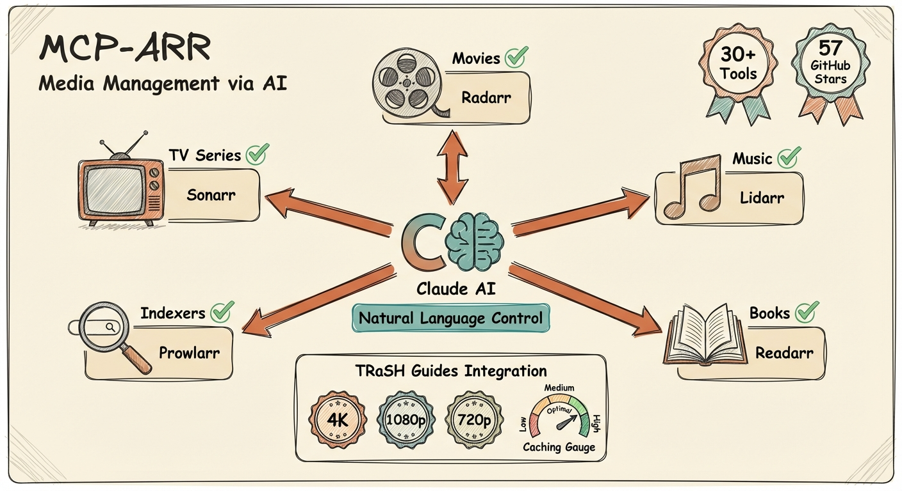

# MCP *arr Server



<!-- <p align="center">
  
</p> -->

[](https://oathe.ai/report/aplaceforallmystuff/mcp-arr)
[](https://www.npmjs.com/package/mcp-arr-server)
[](https://github.com/aplaceforallmystuff/mcp-arr/actions/workflows/ci.yml)
[](https://opensource.org/licenses/MIT)
[](https://modelcontextprotocol.io)

MCP server for the [*arr media management suite](https://wiki.servarr.com/) - Sonarr, Radarr, Lidarr, and Prowlarr, plus [Tautulli](https://tautulli.com/) for Plex statistics, [Overseerr](https://overseerr.dev/) for request management and [Bazarr](https://www.bazarr.media/) for subtitles.

Supports both local `stdio` mode for Claude/Codex-style clients and remote HTTP mode for hosted MCP clients such as ChatGPT connectors.

## Why Use This?

- **Unified media management** - Control all your *arr applications from one interface
- **Natural language queries** - Ask about your library in plain English
- **Cross-service search** - Find content across TV, movies, and music simultaneously
- **Download monitoring** - Check queue status and progress across all services
- **Calendar integration** - See upcoming releases for all media types
- **Configuration review** - Get AI-powered suggestions for optimizing your setup
- **Flexible configuration** - Enable only the services you use

## Features

| Category | Capabilities |
|----------|-------------|
| **Sonarr (TV)** | List series, view episodes, search shows, trigger downloads, check queue, view calendar, review setup |
| **Radarr (Movies)** | List movies, search films, trigger downloads, check queue, view releases, review setup |
| **Lidarr (Music)** | List artists, view albums, search musicians, trigger downloads, check queue, view calendar, review setup |
| **Prowlarr (Indexers)** | List indexers, search across all trackers, test health, view statistics |
| **Tautulli (Plex)** | Activity, history, libraries, users, recently added, server status, terminate session |
| **Overseerr (Requests)** | List requests, approve/decline, view users, search media, request management |
| **Bazarr (Subtitles)** | Missing subtitles, series/episode/movie subtitle status, search & download subtitles, history, providers, languages |
| **Remote server** | Optional HTTPS server with web UI: passkey login per user, encrypted config, offline certificates |
| **Cross-Service** | Status check, unified search across all configured services |
| **Configuration** | Quality profiles, download clients, naming conventions, health checks, storage info |
| **TRaSH Guides** | Reference quality profiles, custom formats, naming conventions, compare against recommendations |

## Prerequisites

- Node.js 20+
- At least one of:
  - *arr application(s) with API access: [Sonarr](https://sonarr.tv/), [Radarr](https://radarr.video/), [Lidarr](https://lidarr.audio/), [Prowlarr](https://prowlarr.com/)
  - [Tautulli](https://tautulli.com/) (Plex monitoring and statistics)
  - [Overseerr](https://overseerr.dev/) (request management for Plex)
  - [Bazarr](https://www.bazarr.media/) (subtitle management for Sonarr/Radarr)

## Installation

### Using npm (Recommended)

```bash
npx mcp-arr-server
```

### Remote HTTP Mode

`MCP_TRANSPORT=http` runs mcp-arr as a shared **HTTPS** server with a web UI, passkey login and per-user access tokens. It needs `PUBLIC_URL` (the browser address, a host name) and stores its settings in an encrypted config file — see [Remote server](#remote-server-docker-https-web-ui-with-passkeys) for setup.

```bash
MCP_TRANSPORT=http PUBLIC_URL=https://mcp-arr.home.lan:3000 CONFIG_ENCRYPTION_KEY=change-me npx mcp-arr-server
```

The MCP endpoint is `/mcp` (`MCP_PATH`), stateless Streamable HTTP, and listens on `0.0.0.0:3000` (`HOST`, `PORT`).

### Docker

This fork publishes an image to GitHub Container Registry on every push to `main`:

```bash
docker pull ghcr.io/htilly/mcp-arr:main
```

Tags: `main` and `main-<short sha>`.

Run in local stdio mode:

```bash
docker run --rm -i \
  -e SONARR_URL=http://host.docker.internal:8989 \
  -e SONARR_API_KEY=your-sonarr-api-key \
  ghcr.io/htilly/mcp-arr:main
```

For remote HTTPS mode with the web UI, use the [`docker-compose.yml`](docker-compose.yml) in this repo (see [Remote server](#remote-server-docker-https-web-ui-with-passkeys)).

#### Building it yourself

Only needed if you are developing against a change that is not released yet:

```bash
docker build -t mcp-arr .
```

### From Source

```bash
git clone https://github.com/aplaceforallmystuff/mcp-arr.git
cd mcp-arr
npm install
npm run build
```

## Configuration

### Getting API Keys

Each *arr application has an API key in Settings > General > Security:

1. Open your *arr application's web interface
2. Go to **Settings** > **General**
3. Find the **API Key** under the Security section
4. Copy the API key for use in configuration

### For Claude Desktop

Add to your Claude Desktop config file:

**macOS**: `~/Library/Application Support/Claude/claude_desktop_config.json`

**Windows**: `%APPDATA%\Claude\claude_desktop_config.json`

```json
{
  "mcpServers": {
    "arr": {
      "command": "npx",
      "args": ["-y", "mcp-arr-server"],
      "env": {
        "SONARR_URL": "http://localhost:8989",
        "SONARR_API_KEY": "your-sonarr-api-key",
        "RADARR_URL": "http://localhost:7878",
        "RADARR_API_KEY": "your-radarr-api-key",
        "LIDARR_URL": "http://localhost:8686",
        "LIDARR_API_KEY": "your-lidarr-api-key",
        "PROWLARR_URL": "http://localhost:9696",
        "PROWLARR_API_KEY": "your-prowlarr-api-key",
        "TAUTULLI_URL": "http://localhost:8181",
        "TAUTULLI_API_KEY": "your-tautulli-api-key",
        "OVERSEERR_URL": "http://localhost:5055",
        "OVERSEERR_API_KEY": "your-overseerr-api-key",
        "BAZARR_URL": "http://localhost:6767",
        "BAZARR_API_KEY": "your-bazarr-api-key"
      }
    }
  }
}
```

### For Claude Code

Add to `~/.claude.json`:

```json
{
  "mcpServers": {
    "arr": {
      "command": "npx",
      "args": ["-y", "mcp-arr-server"],
      "env": {
        "SONARR_URL": "http://localhost:8989",
        "SONARR_API_KEY": "your-sonarr-api-key",
        "RADARR_URL": "http://localhost:7878",
        "RADARR_API_KEY": "your-radarr-api-key"
      }
    }
  }
}
```

**Note**: Only configure the services you have running. The server automatically detects which services are available based on the environment variables you provide.

### Remote server (Docker, HTTPS, web UI with passkeys)

Run mcp-arr **once** on your server (e.g. next to Sonarr/Radarr) and point all MCP clients at one HTTPS URL. A web UI manages service URLs and API keys, users and access tokens. It is built for networks **without internet access**:

- **HTTPS without Let's Encrypt** – a built-in certificate authority issues and renews the server certificate offline. You install its root certificate once per device. The CA is *name-constrained* to your server's names, so it cannot be abused to impersonate other websites. You can also bring your own certificate (step-ca, Caddy, your router, …).
- **Encrypted at rest** – the whole config file (API keys, users, passkeys, token hashes, CA private keys) is AES-256-GCM encrypted.
- **Per-user login with passkeys or name + password** – roles: *admin* (services, users, invites, certificates) and *user* (own sign-in methods and access tokens). Passwords are scrypt-hashed inside the encrypted config; a user can have a password, passkeys, or both.
- **Per-user MCP access tokens** – every client gets its own token, revocable at any time.

> **Claude custom connectors** (claude.ai, mobile, Desktop "Connectors") are called from Anthropic's cloud and need a public internet address with OAuth, so they can't reach an offline server. Use **Claude Code** or **Claude Desktop via `mcp-remote`** – both connect from your own machine.

#### Setup

1. **Pick a host name** and make it resolve on your LAN (router / Pi-hole / AdGuard DNS entry, or the hosts file), e.g. `mcp-arr.home.lan`. Passkeys require a host name — an IP address does not work.
2. **Create the encryption key** (used as a Docker secret):
   ```bash
   openssl rand -base64 32 > mcp-arr-key.txt
   ```
3. Set `PUBLIC_URL` in `docker-compose.yml` (e.g. `https://mcp-arr.home.lan:3000`) and start:
   ```bash
   docker compose up -d
   docker compose logs mcp-arr     # setup code + CA fingerprint
   ```
4. Open `https://mcp-arr.home.lan:3000/ca.crt` (accept the browser warning this once), check that the SHA-256 fingerprint matches the log, and **install the root certificate** (the web UI's *Certificates* tab has steps for macOS, Windows, iOS, Android and Linux).
5. Open `https://mcp-arr.home.lan:3000/admin`, enter the setup code and **register your passkey** — you are the first admin.
6. Add your services (**Test**, then **Save** — tools are enabled immediately), invite other people from **Users** (single-use links, 24 h), and create an **access token** per MCP client.

#### Connect MCP clients

Node.js-based clients don't use the system certificate store, so point them at the root certificate with `NODE_EXTRA_CA_CERTS` (not needed with `TLS_MODE=file` and a certificate your system already trusts):

```bash
# Claude Code (set NODE_EXTRA_CA_CERTS in the shell/profile that starts claude)
export NODE_EXTRA_CA_CERTS=/path/to/mcp-arr-ca.crt
claude mcp add --transport http arr https://mcp-arr.home.lan:3000/mcp --header "Authorization: Bearer <token>"
```

```json
// Claude Desktop (claude_desktop_config.json), via the local mcp-remote bridge
{
  "mcpServers": {
    "arr": {
      "command": "npx",
      "args": ["-y", "mcp-remote", "https://mcp-arr.home.lan:3000/mcp", "--header", "Authorization: Bearer <token>"],
      "env": { "NODE_EXTRA_CA_CERTS": "/path/to/mcp-arr-ca.crt" }
    }
  }
}
```

Clients that can't send headers can use `https://…/mcp?token=<token>`. On an offline machine, install `mcp-remote` once while online (`npm i -g mcp-remote`) and use `"command": "mcp-remote"`.

#### Status board and brand guide

The *Services* tab shows a live **status board**: calls per connection, success rate, response times, a 24-hour chart and a live feed. Each MCP tool call animates on the service sketch as it happens. Counts are stored in `stats.json` next to the config file (no tool arguments or results). Every user also gets a *My activity* tab with their own calls, apps (access tokens) and recent sign-ins (browser and OS only, no IP addresses). The *Brand* tab documents the UI's look - logo, colours, type, illustrations, components and motion - with a logo download and copyable CSS tokens.

#### Settings tab (no restart)

Admins can change the certificate mode and every certificate, Let's Encrypt, DNS-provider, OAuth and proxy setting in the web UI (*Settings* tab), instead of in the compose file:

- **Test these settings** checks the form without applying anything and shows a live log. For Let's Encrypt it requests a real certificate from **Let's Encrypt staging** (no rate-limit risk, nothing trusted is issued) using the chosen validation - HTTP or DNS via Cloudflare/acme-dns - and throws it away. For acme-dns it shows the CNAME record to create. For own files it checks that certificate and key match, and it says whether a new built-in CA would be generated and whether OAuth would switch on.
- **Save & apply** stores the values in the encrypted config file and switches immediately: new certificate manager, OAuth on/off, proxy trust. Switching between HTTPS and plain HTTP (`off`) re-opens the listener on the same port and the page reloads. When switching to Let's Encrypt, the current certificate keeps being served until the new one is issued (browsers that remember HSTS would refuse a temporary certificate).
- Secrets (API tokens, HMAC keys) are never sent back to the browser - leave the field empty to keep the saved value.
- **Environment variables always win**: a setting set in the environment is shown read-only with the variable's name. Remove it from your compose file to manage it in the UI. If a setting ever locks you out (e.g. `off` without a proxy), set `TLS_MODE` in the environment and restart.
- Only in the environment: `PUBLIC_URL` (passkeys are bound to its host), `PORT`, `HOST`, `MCP_PATH`, the encryption key settings, and `ACME_DNS_HOOK` (a web UI admin must not be able to run programs on the server).

#### Certificates (`TLS_MODE`)

| Mode | Use when |
|------|----------|
| `internal` (default) | No other CA on your network. Root CA (10 years) + server certificate (397 days, renewed automatically and hot-swapped, no restart). Changing host names outside the CA's name constraints generates a new CA (you'll need to reinstall it) — set `TLS_CA_NAME_CONSTRAINTS=home.lan` to allow any name under a domain. |
| `acme` | You own a domain and want a **publicly trusted certificate** (Let's Encrypt, or any ACME CA) - nothing to install on your devices, and OAuth for Claude/ChatGPT connectors works. Obtained and renewed automatically, hot-swapped without restart. Works for internet-facing servers (`http-01`) **and LAN-only servers** (`dns-01`). See below. |
| `file` | You already run a LAN CA, e.g. [step-ca](https://smallstep.com/docs/step-ca/) (which also offers ACME for automatic renewal on an offline network), Caddy's internal CA, your router/NAS, or a certificate obtained elsewhere via DNS-01. Set `TLS_CERT_FILE` / `TLS_KEY_FILE`; files are reloaded automatically when they change. |
| `off` | A reverse proxy in front terminates HTTPS. Set `TRUST_PROXY=true` so rate limiting uses `X-Forwarded-For`. `PUBLIC_URL` must still be the proxy's `https://` address. |

#### Let's Encrypt (`TLS_MODE=acme`)

The certificate covers the `PUBLIC_URL` host name plus any DNS names in `TLS_SANS` (or exactly `ACME_DOMAINS`). Account and certificate keys are stored in the encrypted config file. The certificate is renewed when a third of its lifetime is left (30 days for Let's Encrypt's 90-day certificates); until the first one is issued, a temporary self-signed certificate is served. Failed requests are retried with back-off (15 min, 30 min, 1 h ... 12 h) to stay within Let's Encrypt's rate limits. Start with `ACME_STAGING=true` and switch it off once the log says `certificate issued` - the account and certificate are re-requested automatically.

Choose how the CA checks that you control the name:

| Your server | Challenge | What you need |
|-------------|-----------|---------------|
| Reachable from the internet on port 80 | `http-01` (default) | Port 80 forwarded to the server. A small listener on `ACME_HTTP_PORT` (default 80; 8080 in the Docker image - publish it with `"80:8080"`) answers the check and redirects everything else to `PUBLIC_URL`. |
| LAN only, or a wildcard name | `dns-01` (set `ACME_DNS_PROVIDER`) | A DNS record is created for the check - nothing has to be reachable from the internet. The name must still resolve to the server on your LAN (local DNS record in your router/Pi-hole/UniFi). |

DNS providers for `dns-01`:

- **`cloudflare`**: `CLOUDFLARE_DNS_API_TOKEN` (an API token with *Zone:Read* + *DNS:Edit*, ideally limited to the zone). The zone is found automatically; set `CLOUDFLARE_ZONE_ID` to skip the lookup.
- **`acme-dns`**: works with **every DNS provider** and needs no DNS credentials at all. On first start the server registers at an [acme-dns](https://github.com/joohoi/acme-dns) server (`ACMEDNS_API_BASE`, default `https://auth.acme-dns.io` - better: run your own) and the log and the web UI's *Certificates* tab show one CNAME record to create, e.g. `_acme-challenge.mcp-arr.example.com CNAME 1b2c....auth.acme-dns.io`. The server checks every two minutes and continues on its own once the record exists. To use an existing acme-dns account, set `ACMEDNS_USERNAME`, `ACMEDNS_PASSWORD` and `ACMEDNS_SUBDOMAIN`.
- **`exec`**: `ACME_DNS_HOOK=/path/to/script`, called as `script present <fqdn> <value>` and `script cleanup <fqdn> <value>` (the same interface as lego's `exec` provider), for any DNS API you can script.

Before asking the CA, the server waits until the TXT record is visible on public resolvers (`ACME_DNS_RESOLVERS`, default `1.1.1.1,8.8.8.8`, up to `ACME_DNS_TIMEOUT` seconds) plus `ACME_DNS_DELAY` seconds.

Other ACME CAs: set `ACME_DIRECTORY_URL` (e.g. ZeroSSL `https://acme.zerossl.com/v2/DV90`, Google Trust Services, or your own step-ca), plus `ACME_EAB_KID` / `ACME_EAB_HMAC_KEY` when the CA requires external account binding. `ACME_PROFILE` selects a certificate profile (e.g. Let's Encrypt `shortlived`). TLS-ALPN-01 is not supported; use `http-01` or `dns-01`.

Example: LAN-only server with Cloudflare DNS

```yaml
    environment:
      MCP_TRANSPORT: http
      PUBLIC_URL: https://mcp-arr.example.com:3000   # local DNS record -> the server's LAN IP
      TLS_MODE: acme
      ACME_DNS_PROVIDER: cloudflare
      CLOUDFLARE_DNS_API_TOKEN: ${CF_TOKEN}
```

Example: internet-facing server on the standard ports

```yaml
    ports:
      - "443:3000"
      - "80:8080"
    environment:
      MCP_TRANSPORT: http
      PUBLIC_URL: https://mcp-arr.example.com
      TLS_MODE: acme
      ACME_EMAIL: you@example.com
```

#### Sign-in for Claude and ChatGPT connectors (OAuth)

Claude "custom connectors" and OpenAI/ChatGPT connectors are called from the vendors' clouds, so they need an address reachable from the internet **and a publicly trusted certificate** (`TLS_MODE=acme`, `TLS_MODE=file` with e.g. a Let's Encrypt certificate, or a reverse proxy with `TLS_MODE=off`). When that is the case the server automatically offers OAuth 2.1 sign-in, so nobody has to paste an access token:

1. In Claude (Settings → Connectors → Add custom connector) or ChatGPT (developer mode → add connector) enter `https://<PUBLIC_URL>/mcp`. Leave the OAuth client fields empty - the connector registers itself (RFC 7591).
2. You are sent to the web UI, sign in with your usual passkey or password, and approve the connection.
3. The connector gets a 1-hour access token and a rotating refresh token. They show up under "Access tokens" as `OAuth: <connector>` and can be revoked there; deleting the user revokes them too.

OAuth is **off** with `TLS_MODE=internal` (the built-in CA is not trusted by Claude/OpenAI), with an `http://` `PUBLIC_URL`, when a `TLS_MODE=file` certificate is self-signed, expired or does not cover the host name, or with `TLS_MODE=acme` and `ACME_STAGING=true` or a custom `ACME_DIRECTORY_URL`. The startup log and the "Connect" tab say why. Redirect URIs are limited to `claude.ai`, `claude.com`, `chatgpt.com`, `openai.com` (and subdomains) plus loopback addresses; add more hosts with `OAUTH_ALLOWED_REDIRECT_HOSTS`. Endpoints: `/.well-known/oauth-protected-resource`, `/.well-known/oauth-authorization-server`, `/oauth/register`, `/oauth/authorize`, `/oauth/token`, `/oauth/revoke`. Manually created access tokens keep working alongside OAuth.

#### Encryption key

Resolved in this order:

1. `CONFIG_ENCRYPTION_KEY` – passphrase in an environment variable
2. `CONFIG_ENCRYPTION_KEY_FILE` – file containing the passphrase (recommended: a Docker secret, see `docker-compose.yml`)
3. Otherwise a random key file is created at `KEY_FILE_PATH` (Docker: `/secrets/master.key`). This protects a copied config file, but not someone who has both volumes — the UI and log show a warning. Keep it on a separate volume.

Switching from the key file to a passphrase is automatic (the file is re-encrypted on start). To change passphrases, start once with the old one in `CONFIG_ENCRYPTION_KEY_PREVIOUS`. Without the right key the server refuses to start — **back up your key**; there is no way to recover the data without it.

#### HTTP mode settings

All `TLS_*`, `ACME_*`, DNS-provider and `OAUTH*` variables and `TRUST_PROXY` can also be set in the *Settings* tab (see above); environment variables take precedence.

| Variable | Default | Description |
|----------|---------|-------------|
| `MCP_TRANSPORT` | `stdio` | Set to `http` for the remote server |
| `PUBLIC_URL` | – (required) | The URL you open in the browser, e.g. `https://mcp-arr.home.lan:3000` (passkey origin + certificate name) |
| `PORT` / `HOST` | `3000` / `0.0.0.0` | Listen address |
| `TLS_MODE` | `internal` | `internal`, `file`, `acme` or `off` (see above) |
| `TLS_SANS` | – | Extra names/IPs for the certificate, comma-separated |
| `TLS_CA_NAME_CONSTRAINTS` | names from `PUBLIC_URL` + `TLS_SANS` | Domains/IPs the built-in CA may issue for |
| `TLS_CERT_FILE` / `TLS_KEY_FILE` | – | Certificate and key for `TLS_MODE=file` |
| `ACME_EMAIL` | – | Contact address for the ACME account (optional) |
| `ACME_STAGING` | `false` | `true` uses Let's Encrypt staging (untrusted test certificates, generous rate limits) |
| `ACME_DOMAINS` | `PUBLIC_URL` host + DNS names in `TLS_SANS` | Names for the certificate, comma-separated; `*.example.com` needs dns-01 |
| `ACME_CHALLENGE` | `http-01`, or `dns-01` when `ACME_DNS_PROVIDER` is set | Validation method |
| `ACME_HTTP_PORT` | `80` (Docker: `8080`) | Listener for http-01; port 80 on the internet must reach it |
| `ACME_DNS_PROVIDER` | – | `cloudflare`, `acme-dns` or `exec` (dns-01) |
| `CLOUDFLARE_DNS_API_TOKEN` / `CLOUDFLARE_ZONE_ID` | – | Cloudflare token (Zone:Read + DNS:Edit) / optional zone id |
| `ACMEDNS_API_BASE` | `https://auth.acme-dns.io` | acme-dns server; `ACMEDNS_USERNAME` / `_PASSWORD` / `_SUBDOMAIN` for an existing account |
| `ACME_DNS_HOOK` | – | Script for `exec`: `<script> present\|cleanup <fqdn> <value>` |
| `ACME_DNS_RESOLVERS` / `ACME_DNS_TIMEOUT` / `ACME_DNS_DELAY` | `1.1.1.1,8.8.8.8` / `300` / `10` | Propagation check before validation (seconds) |
| `ACME_DIRECTORY_URL` | Let's Encrypt | Other ACME CA; `ACME_EAB_KID` / `ACME_EAB_HMAC_KEY` for external account binding |
| `ACME_PROFILE` | – | Certificate profile, e.g. `shortlived` |
| `CONFIG_PATH` | `/config/config.json` (Docker) | Encrypted config file |
| `CONFIG_ENCRYPTION_KEY` / `_FILE` / `_PREVIOUS` | – | Encryption key (see above) |
| `KEY_FILE_PATH` | `/secrets/master.key` (Docker) | Fallback auto-generated key file |
| `ADMIN_RECOVERY` | `false` | `true` prints a one-time recovery code to register a new admin passkey |
| `TRUST_PROXY` | `false` | Trust `X-Forwarded-For` (only behind your own reverse proxy) |
| `OAUTH` | `auto` | OAuth sign-in for Claude/OpenAI connectors: `auto` (only with a publicly trusted certificate setup, see above), `on` (force; you vouch for the certificate), `off` |
| `OAUTH_ALLOWED_REDIRECT_HOSTS` | – | Extra redirect hosts connectors may use, comma-separated (defaults: claude.ai, claude.com, chatgpt.com, openai.com) |

Service variables (`SONARR_URL`, `SONARR_API_KEY`, …) still work and take precedence over the web UI, where they show as read-only.

**Offline notes:** everything works without internet except the TRaSH Guides tools, which fetch guide data from GitHub and return an error when offline. To install on an air-gapped host, build the image elsewhere and move it with `docker save` / `docker load`.

#### Self-hosted deploy (the "Deploy to tillyse" workflow)

The repo's `deploy.yml` pulls the image built from `main` and recreates the `mcp-arr` service on a self-hosted runner, then checks that the server answers. Because the server now enforces authentication, that check accepts `401` with a `WWW-Authenticate: Bearer` challenge as "up", and optionally runs a full authenticated `initialize`.

1. **The compose service on the host** must run the HTTPS mode, or the new image refuses to start (and the deploy rolls back automatically). Example for the service in `/config/docker-compose.yml` — the `image:` line must stay exactly as shown, the workflow's preflight greps for it:

   ```yaml
     mcp-arr:
       image: ghcr.io/htilly/mcp-arr:main
       environment:
         MCP_TRANSPORT: http
         HOST: 0.0.0.0
         PORT: 3000
         PUBLIC_URL: https://mcp-arr.home.lan:3000      # the name you open in the browser
         TLS_SANS: mcp-arr                              # + any other name/IP the runner or clients use
         CONFIG_ENCRYPTION_KEY_FILE: /run/secrets/mcp_arr_key
       volumes:
         - /config/mcp-arr/data:/config                 # encrypted config; keep it across deploys
       secrets: [mcp_arr_key]
       healthcheck:
         test: ["CMD", "wget", "-q", "--no-check-certificate", "-O-", "https://127.0.0.1:3000/health"]
   secrets:
     mcp_arr_key:
       file: /config/secrets/mcp-arr-key.txt           # openssl rand -base64 32 > mcp-arr-key.txt
   ```

2. **The runner's environment** (`/config/secrets/mcp-arr-runner.env`): set `APP_URL` to an address that is in the server certificate (`PUBLIC_URL` host or `TLS_SANS`), e.g. `APP_URL=https://mcp-arr:3000`. Two optional variables make the check stricter:

   | Variable | Effect |
   |----------|--------|
   | `MCP_ARR_CA_FILE` | Path to a copy of the server's root certificate (`/ca.crt`). Without it, a certificate the runner doesn't trust is checked with verification **off** (liveness only, with a warning) and no token is ever sent. |
   | `MCP_CHECK_TOKEN` | An access token (create a "deploy" user in the web UI and a token for it). With it, the deploy also runs an authenticated `initialize`, so a broken auth setup fails the deploy instead of passing on the `401`. Only sent over verified HTTPS, never printed. |

The first deploy of the HTTPS version can still fail and roll back to an older image that speaks plain HTTP. When `APP_URL` is `https://`, the rollback step also accepts the same host:port over plain HTTP (liveness only, with a warning, never with the token), so the rollback is not reported as failed just because the old image has no TLS.

### Using the local build (Cursor / Claude)

If you develop from source and run `npm run build`, the **published npm package** used by `npx mcp-arr-server` is an older version. To use your local build and latest code (e.g. Tautulli history with pagination):

1. **Point the MCP server at your built file** and pass env vars in your MCP config.

2. **Cursor**: In Cursor Settings → MCP (or the MCP config file Cursor uses), add or edit the mcp-arr server so it runs the local build and has env vars:

```json
{
  "mcpServers": {
    "arr": {
      "command": "node",
      "args": ["/absolute/path/to/mcp-arr/dist/index.js"],
      "env": {
        "TAUTULLI_URL": "http://localhost:8181",
        "TAUTULLI_API_KEY": "your-tautulli-api-key",
        "SONARR_URL": "http://localhost:8989",
        "SONARR_API_KEY": "your-sonarr-api-key"
      }
    }
  }
}
```

Use your actual paths and API keys. Only include the services you use.

3. **Restart the MCP server** (e.g. restart Cursor or use “Restart” on the mcp-arr server in Cursor’s MCP list) after each `npm run build` so the new code is loaded.

4. **Claude Desktop**: Same idea — set `"command": "node"` and `"args": ["/absolute/path/to/mcp-arr/dist/index.js"]` with `env` in `claude_desktop_config.json`.

**TRaSH-only mode**: if you don’t configure any *arr services, the server still starts and exposes the TRaSH Guides reference tools plus generic `search` and `fetch`.

## ChatGPT / Remote MCP

To use `mcp-arr` with ChatGPT, run the server in remote HTTP mode on a reachable host and connect ChatGPT to the `/mcp` endpoint. Note that ChatGPT (like Claude custom connectors) connects from the vendor's cloud, so the server must be reachable from the internet with a publicly trusted certificate, and the client must be able to send the access token (`Authorization: Bearer` or `?token=`).

The server now exposes the generic `search` and `fetch` tools expected by ChatGPT-style remote MCP integrations:

- `search` discovers matching *arr media and TRaSH profiles
- `fetch` returns structured detail for a selected search result

The existing service-specific tools remain available for richer local or power-user workflows.

## Usage Examples

### Library Management
- "Show me all my TV series"
- "What movies do I have in Radarr?"
- "List all artists in my music library"

### Searching & Adding Content
- "Search for sci-fi shows on Sonarr"
- "Find action movies from the 90s"
- "Add this show to my TV library"
- "Add that movie to Radarr"
- "Search for jazz albums and add this artist"
- "Add this movie with my '4k' tag"
- "What tags do I have in Sonarr?"

### Download Queue
- "What's downloading right now?"
- "Check the Sonarr queue"
- "Show Radarr download progress"

### Upcoming Releases
- "What TV episodes are coming this week?"
- "Show upcoming movie releases"
- "Any new albums coming out this month?"

### Downloading Content
- "What episodes of this show am I missing?"
- "Download the missing episodes for that series"
- "Search for this specific movie"
- "Grab that album I'm missing"

### Indexer Management
- "Are my indexers healthy?"
- "How are my indexers performing?"
- "Test all my Prowlarr indexers"

### Configuration Review
- "Review my Sonarr setup and suggest improvements"
- "Show me my quality profiles in Radarr"
- "Are there any health issues with my Lidarr?"
- "What naming convention am I using for TV shows?"
- "Help me understand my quality profiles - why am I not getting 4K?"
- "Check my download client configuration"
- "How much free space do I have on my root folders?"

### Cross-Service
- "Check status of all my *arr services"
- "Search for 'comedy' across all services"

## Discovering tools and options

The MCP server exposes every tool with its full **inputSchema** (parameters, types, enums, descriptions). When your client connects, it receives this via **ListTools**, so the AI already knows what each tool does and which options it accepts.

You can ask in plain language, for example:
- *"What tools does the arr server have?"*
- *"What parameters does radarr_get_movies accept?"*
- *"How do I get only the first 100 movies from Radarr?"*
- *"Can I sort Sonarr series by size on disk?"*

The AI will answer from the tool definitions (sortBy, limit, etc.) without needing to read this README.

## Available Tools

### General Tools

| Tool | Description |
|------|-------------|
| `arr_status` | Get connection status for all configured *arr services |
| `arr_search_all` | Search across all configured services simultaneously |
| `search` | Generic discovery tool for remote MCP clients such as ChatGPT |
| `fetch` | Generic detail-fetch tool for items returned by `search` |

**Note:** `radarr_get_movies`, `radarr_search`, and `sonarr_get_series` include `imdbId`, `rating` (TMDB/TVDB), and `ratingVotes` from the connected *arr services.

### Sonarr Tools (TV)

| Tool | Description |
|------|-------------|
| `sonarr_get_series` | List TV series in your library, with `limit`/`offset`/`search` pagination and optional `sortBy` (dateAdded, sizeOnDisk) / `sortDir` (asc, desc). Includes `imdbId` and rating |
| `sonarr_search` | Search for TV series by name (returns tvdbId for adding) |
| `sonarr_add_series` | Add a TV series to Sonarr (supports tags) |
| `sonarr_get_root_folders` | Get available root folders for adding series |
| `sonarr_get_quality_profiles` | Get available quality profiles for adding series |
| `sonarr_get_queue` | View current download queue with `limit` and `offset` pagination |
| `sonarr_get_calendar` | See upcoming episodes |
| `sonarr_get_episodes` | List episodes for a series (shows missing vs available; includes episodeFileId for delete) |
| `sonarr_search_missing` | Trigger search for all missing episodes in a series |
| `sonarr_search_episode` | Trigger search for specific episode(s) |
| `sonarr_delete_series` | Delete a whole series (optionally delete files, add import list exclusion) |
| `sonarr_delete_season` | Delete all episode files for a specific season |
| `sonarr_delete_episode_files` | Delete specific episode file(s) by episode file ID |
| `sonarr_refresh_series` | Trigger a metadata refresh for a specific series in Sonarr |

### Radarr Tools (Movies)

| Tool | Description |
|------|-------------|
| `radarr_get_movies` | List movies in your library, with `limit`/`offset`/`search` pagination and optional `sortBy` (dateAdded, sizeOnDisk) / `sortDir` (asc, desc). Includes `imdbId` and rating |
| `radarr_search` | Search for movies by name (returns tmdbId for adding) |
| `radarr_add_movie` | Add a movie to Radarr (supports tags) |
| `radarr_get_root_folders` | Get available root folders for adding movies |
| `radarr_get_quality_profiles` | Get available quality profiles for adding movies |
| `radarr_get_queue` | View current download queue with `limit` and `offset` pagination |
| `radarr_get_calendar` | See upcoming releases |
| `radarr_search_movie` | Trigger search to download a movie in your library |
| `radarr_search_movies` | Bulk-trigger searches for multiple movie IDs at once |
| `radarr_update_movie` | Update a movie's quality profile, monitored status, minimum availability, tags, or path |
| `radarr_delete_queue_item` | Remove an item from the download queue (optionally blocklist the release) |
| `radarr_refresh_movie` | Trigger a metadata refresh for a specific movie in Radarr |
| `radarr_delete_movie` | Delete a movie (optionally delete files from disk, add import exclusion) |

### Lidarr Tools (Music)

| Tool | Description |
|------|-------------|
| `lidarr_get_artists` | List all artists in your library |
| `lidarr_search` | Search for artists by name (returns foreignArtistId for adding) |
| `lidarr_add_artist` | Add an artist to Lidarr (supports tags) |
| `lidarr_get_root_folders` | Get available root folders for adding artists |
| `lidarr_get_quality_profiles` | Get available quality profiles for adding artists |
| `lidarr_get_metadata_profiles` | Get available metadata profiles for adding artists |
| `lidarr_get_queue` | View current download queue with `limit` and `offset` pagination |
| `lidarr_get_albums` | List albums for an artist (shows missing vs available) |
| `lidarr_search_album` | Trigger search for a specific album |
| `lidarr_search_missing` | Trigger search for all missing albums for an artist |
| `lidarr_get_calendar` | See upcoming album releases |

### Prowlarr Tools (Indexers)

| Tool | Description |
|------|-------------|
| `prowlarr_get_indexers` | List all configured indexers |
| `prowlarr_search` | Search across all indexers |
| `prowlarr_test_indexers` | Test all indexers and return health status |
| `prowlarr_get_stats` | Get indexer statistics (queries, grabs, failures) |

### Tautulli Tools (Plex)

When `TAUTULLI_URL` and `TAUTULLI_API_KEY` are set:

| Tool | Description |
|------|-------------|
| `tautulli_get_activity` | Current Plex activity (now playing) |
| `tautulli_get_history` | Watch history. With title: search by movie/series – shows who watched and when (or empty if no one in last ~2000 plays) |
| `tautulli_get_libraries` | Plex libraries |
| `tautulli_get_server_info` | Plex server info |
| `tautulli_get_home_stats` | Home stats (plays, duration) |
| `tautulli_get_users` | Plex users |
| `tautulli_get_recently_added` | Recently added media |
| `tautulli_server_status` | Tautulli/Plex server status |
| `tautulli_terminate_session` | Terminate a streaming session |

`arr_status` includes Tautulli connection status when configured.

### Overseerr Tools (Requests)

When `OVERSEERR_URL` and `OVERSEERR_API_KEY` are set:

| Tool | Description |
|------|-------------|
| `overseerr_get_requests` | List media requests with status, requester, and media details. Filter by status (pending, approved, etc.) |
| `overseerr_get_request_count` | Get request counts by status (pending, approved, declined, etc.) |
| `overseerr_get_users` | List Overseerr users with their request counts |
| `overseerr_get_user_requests` | Get all requests made by a specific user |
| `overseerr_approve_request` | Approve a pending media request |
| `overseerr_decline_request` | Decline a pending media request |
| `overseerr_search` | Search for movies and TV shows (uses TMDB) |
| `overseerr_status` | Get Overseerr server status and version |

`arr_status` includes Overseerr connection status when configured.

### Bazarr Tools (Subtitles)

When `BAZARR_URL` and `BAZARR_API_KEY` are set (API key: Bazarr → Settings → General → Security):

| Tool | Description |
|------|-------------|
| `bazarr_status` | Bazarr system status (Bazarr/Sonarr/Radarr versions) |
| `bazarr_get_health` | Health check issues |
| `bazarr_get_badges` | Counts of episodes/movies missing subtitles and provider/health issues |
| `bazarr_get_series` | Series with language profile and missing-subtitle counts |
| `bazarr_get_episodes` | Episodes of a series with existing and missing subtitles (optional season filter) |
| `bazarr_get_movies` | Movies with existing and missing subtitles |
| `bazarr_get_wanted_episodes` | Episodes missing subtitles |
| `bazarr_get_wanted_movies` | Movies missing subtitles |
| `bazarr_get_history` | Subtitle history for episodes or movies |
| `bazarr_search_series` | Search all missing subtitles for a series |
| `bazarr_search_movie` | Search all missing subtitles for a movie |
| `bazarr_download_episode_subtitle` | Search & download a subtitle in a given language for an episode (forced/HI optional) |
| `bazarr_download_movie_subtitle` | Search & download a subtitle in a given language for a movie (forced/HI optional) |
| `bazarr_get_providers` | Subtitle provider status (throttled providers) |
| `bazarr_reset_providers` | Reset throttled providers |
| `bazarr_get_languages` | Enabled languages and language profiles |

Series and episode IDs are Sonarr IDs; movie IDs are Radarr IDs. `arr_status` includes Bazarr connection status when configured.

### Configuration Review Tools

These tools are available for Sonarr, Radarr, and Lidarr. Replace `{service}` with the service name (e.g., `sonarr_get_quality_profiles`).

| Tool | Description |
|------|-------------|
| `{service}_get_quality_profiles` | Detailed quality profile information with allowed qualities and custom format scores |
| `{service}_get_health` | Health check warnings and issues detected by the application |
| `{service}_get_root_folders` | Storage paths, free space, and accessibility status |
| `{service}_get_download_clients` | Download client configurations and settings |
| `{service}_get_naming` | File and folder naming conventions |
| `{service}_get_tags` | Tag definitions for content organization |
| `{service}_review_setup` | **Comprehensive configuration dump for AI-assisted setup analysis** |

The `{service}_review_setup` tool returns all configuration in a single call, enabling natural language conversations about optimizing your setup. Claude can analyze your quality profiles, suggest improvements, explain why certain content isn't being grabbed, and help configure complex settings like custom formats.

> **⚠️ Disclaimer**: The configuration review tools provide **read-only** access to your *arr settings. Any changes to your configuration must be made directly in the *arr application interfaces. The AI's suggestions are recommendations only - always back up your configuration before making significant changes. The maintainers are not responsible for any configuration changes, data loss, or other issues that may arise from following AI-generated recommendations.

### TRaSH Guides Tools

Access community-curated quality profiles, custom formats, and naming conventions from [TRaSH Guides](https://trash-guides.info/) directly through Claude or ChatGPT. These tools work without any *arr configuration - they fetch reference data from the TRaSH Guides GitHub repository.

| Tool | Description |
|------|-------------|
| `trash_list_profiles` | List available TRaSH quality profiles for Radarr or Sonarr |
| `trash_get_profile` | Get detailed profile with custom formats, scores, and quality settings |
| `trash_list_custom_formats` | List custom formats with optional category filter (hdr, audio, resolution, etc.) |
| `trash_get_naming` | Get recommended naming conventions for Plex, Emby, Jellyfin, or standard |
| `trash_get_quality_sizes` | Get recommended min/max/preferred sizes for each quality level |
| `trash_compare_profile` | Compare your profile against TRaSH recommendations (requires *arr configured) |
| `trash_compare_naming` | Compare your naming config against TRaSH recommendations (requires *arr configured) |

**Example usage:**
- "What quality profiles does TRaSH recommend for 4K movies?"
- "Show me the remux-web-1080p profile details"
- "Compare my Radarr profile 4 against the TRaSH uhd-bluray-web profile"
- "What naming convention should I use for Plex?"
- "List HDR-related custom formats for Radarr"

Data is cached for 1 hour to minimize GitHub API calls.

## Development

```bash
# Watch mode for development
npm run watch

# Build TypeScript
npm run build

# Test connections to all configured services (reads test-config.txt or env)
npm run test

# Run locally
SONARR_URL="http://localhost:8989" SONARR_API_KEY="your-key" node dist/index.js
```

For `npm run test`, set URL and API key in `test-config.txt` (project root, .env-style) or as environment variables. The script tests Sonarr, Radarr, Lidarr, Readarr, Prowlarr, Tautulli, Overseerr, and Bazarr; Tautulli gets a detailed output (recent history, users) when configured.

## Troubleshooting

### "No *arr services configured"
Ensure you have set at least one pair of URL and API_KEY environment variables:
```bash
SONARR_URL="http://localhost:8989"
SONARR_API_KEY="your-api-key"
```

### "API error: 401 Unauthorized"
The API key is incorrect. Verify it in your *arr application under Settings > General > Security.

### "fetch failed" or "ECONNREFUSED"
The *arr application is not running or the URL is incorrect. Verify:
- The application is running
- The URL and port are correct
- There's no firewall blocking the connection

### "Sonarr/Radarr/etc not configured"
You tried to use a tool for a service that isn't configured. Add the corresponding URL and API_KEY environment variables (or configure it in the web UI in HTTP mode).

### HTTP mode: "Unauthorized" from `/mcp`
Create an access token in the web UI (**Access tokens**) and send it as `Authorization: Bearer <token>`. Tokens stop working when they are revoked or their user is deleted.

### HTTP mode: certificate errors (`self-signed certificate in certificate chain`, `UNABLE_TO_VERIFY_LEAF_SIGNATURE`)
Install the root certificate from `/ca.crt` on the device, and for Node.js clients (Claude Code, `mcp-remote`) set `NODE_EXTRA_CA_CERTS=/path/to/mcp-arr-ca.crt`. Connect using a name that is in the certificate (`PUBLIC_URL` host or `TLS_SANS`).

### HTTP mode: passkey prompt fails or "Passkeys unavailable"
Passkeys only work over trusted HTTPS on the exact host name in `PUBLIC_URL` (not an IP address, not a different alias). Install the root certificate and open the configured URL.
The error message now includes the browser's error name. Until that is fixed you can sign in with a name and password (set one under "My sign-in", or choose a password during setup).

### HTTP mode: lost all admin passkeys
Start the server once with `ADMIN_RECOVERY=true`. The log shows a one-time recovery code; on the sign-in page choose "Lost your passkey?" to register a new admin. Remove the variable afterwards.

### HTTP mode: "encryption key does not match" / "no key is available"
The config file was encrypted with a different key. Start with the original `CONFIG_ENCRYPTION_KEY` (or restore the key file). To change keys, put the old one in `CONFIG_ENCRYPTION_KEY_PREVIOUS` for one start. Without the key the data can't be recovered — move the config file away to start fresh.

## Need help building or securing MCP servers?

I build and maintain MCP servers like this one, and I review AI and agent setups for security. If your team needs a custom server, an integration, or a security review of one you already run, see [jimchristian.net/work](https://jimchristian.net/work/) or book a [discovery session](https://jimchristian.net/discovery/).

## License

MIT - see [LICENSE](LICENSE) for details.

## Links

- [Servarr Wiki](https://wiki.servarr.com/) - Documentation for all *arr applications
- [TRaSH Guides](https://trash-guides.info/) - Quality profiles, custom formats, and setup guides
- [Sonarr API Docs](https://sonarr.tv/docs/api/)
- [Model Context Protocol](https://modelcontextprotocol.io)
- [GitHub Repository](https://github.com/aplaceforallmystuff/mcp-arr)
